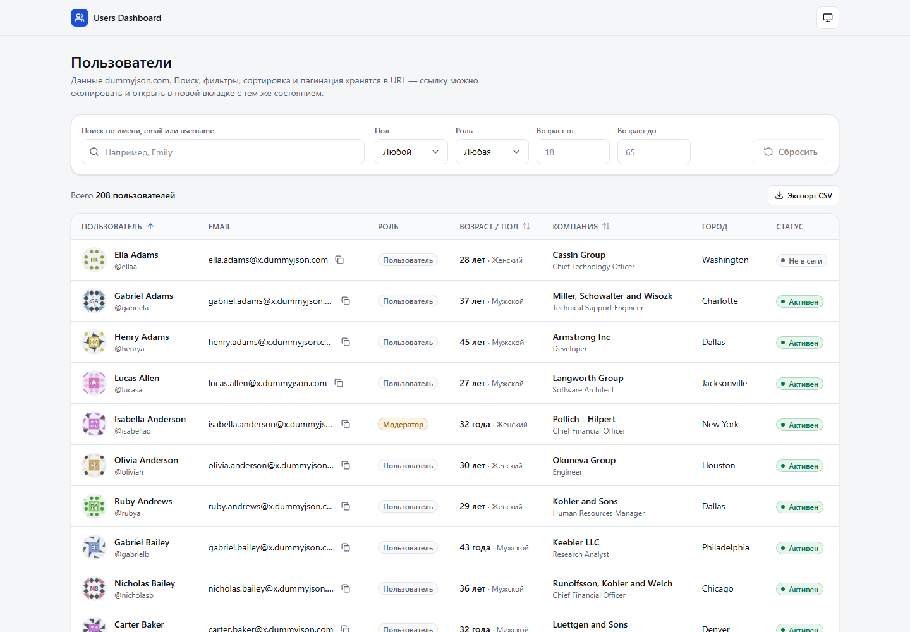
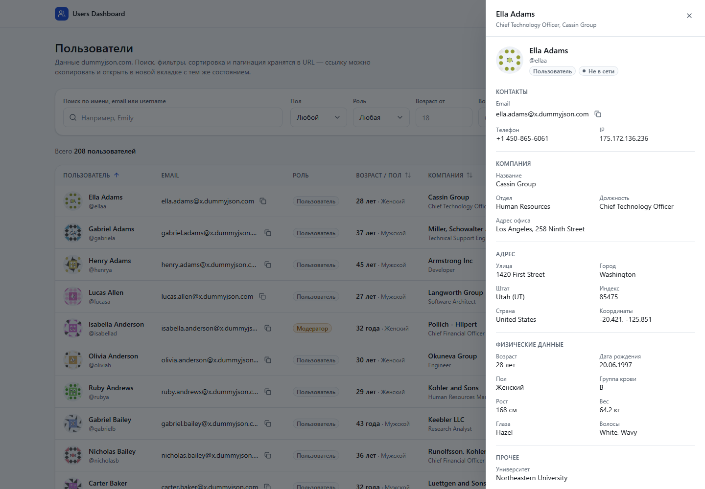
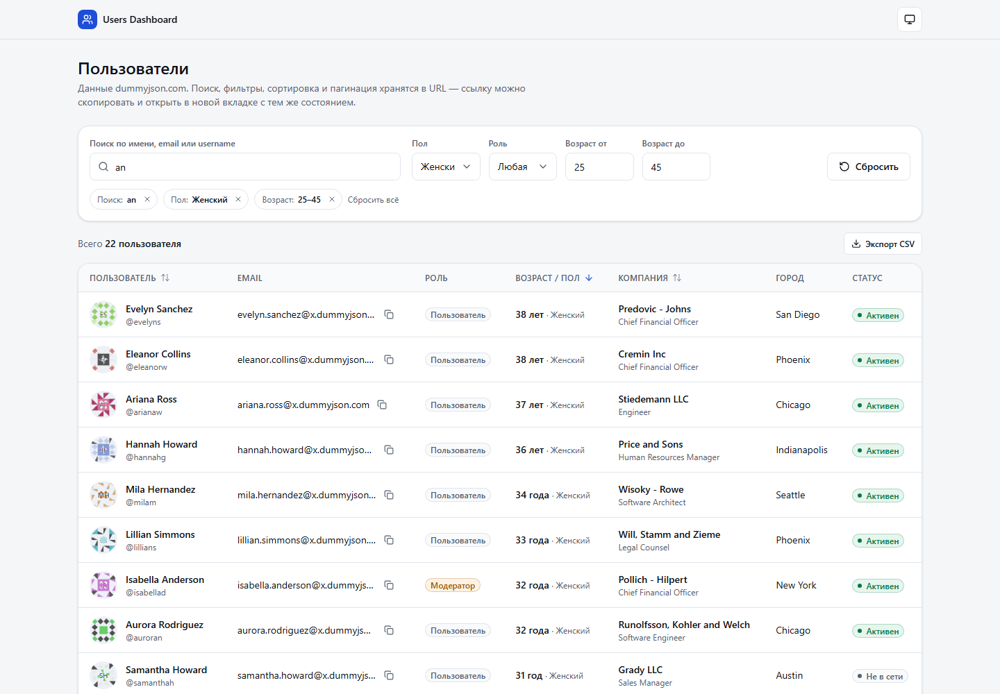
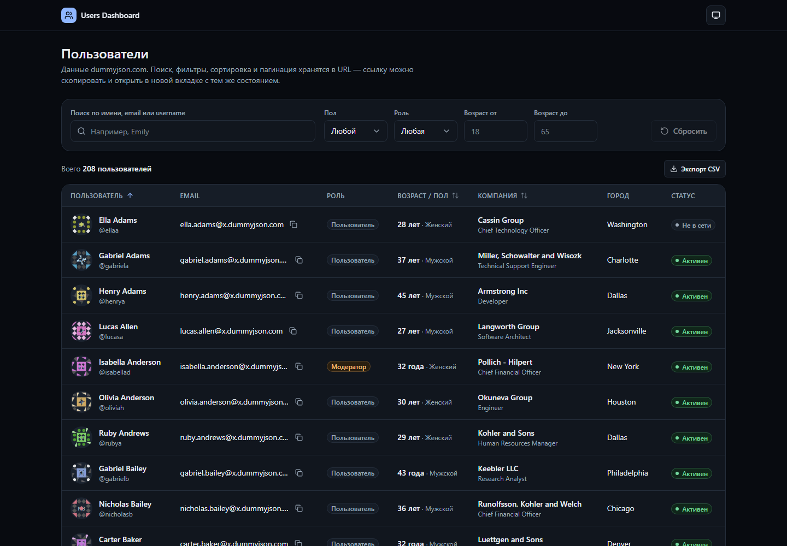
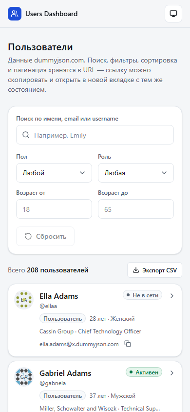

# Users Dashboard

[](https://github.com/BirmiiiYo/users-dashboard/actions/workflows/deploy.yml)
[](https://users-dashboard.vercel.app)

**Демо: https://users-dashboard.vercel.app** — деплой автоматический: пуш в `main` → GitHub Actions
(`lint → typecheck → unit → e2e → build`) → `vercel deploy --prod`. Красный CI не доезжает до прода.

Дашборд пользователей на данных [dummyjson.com/users](https://dummyjson.com/docs/users): таблица с поиском,
фильтрами, сортировкой, пагинацией, карточкой пользователя и экспортом в CSV. Состояние экрана живёт в URL —
ссылку можно скопировать и открыть с тем же результатом.



| Карточка пользователя | Поиск + фильтры + сортировка |
| --- | --- |
|  |  |

| Тёмная тема | Мобильный вид (карточки вместо таблицы) |
| --- | --- |
|  |  |

## Быстрый старт

```bash
pnpm install
pnpm dev        # http://localhost:3000
```

Проверки:

```bash
pnpm lint        # ESLint (next/core-web-vitals + next/typescript + prettier)
pnpm typecheck   # tsc --noEmit, strict + noUncheckedIndexedAccess
pnpm test        # Vitest: 56 тестов на логику и компоненты
pnpm test:e2e    # Playwright: 2 сценария (happy path + сохранение темы)
pnpm build       # production build
```

Скриншоты для README (нужен запущенный сервер):

```bash
pnpm screenshots              # BASE_URL по умолчанию http://127.0.0.1:3000
```

Требования: Node 22+, pnpm 10+.

## Что умеет

- **Таблица**: аватар, имя/username, email (с копированием), роль, возраст/пол, компания и должность, город, статус.
- **Поиск** с debounce 350 мс — серверный, через `/users/search` (dummyjson ищет по имени, email, username).
- **Фильтры**: пол, роль, диапазон возраста (debounce 400 мс), активные фильтры — чипами, снимаются по одному или все сразу.
- **Сортировка** по имени, возрасту, компании; `aria-sort` и индикатор направления; повторный клик переворачивает порядок.
- **Пагинация** 10/20/50, окно страниц, «Всего N пользователей», клампинг страницы, если данных стало меньше.
- **Карточка пользователя** в выезжающей панели: контакты, компания, адрес, физические данные.
- **Экспорт CSV** текущей выборки (фильтр + сортировка, все страницы) через серверный route.
- **Тёмная/светлая/системная тема** без мигания при загрузке, выбор запоминается.
- **Состояния**: skeleton при загрузке (геометрия совпадает с таблицей), ошибка с повтором, «ничего не найдено» со сбросом фильтров, приглушение устаревших данных во время навигации.
- **Адаптив**: до `md` таблица заменяется карточками.

## Стек и почему такой

| Выбор | Почему |
| --- | --- |
| Next.js 15 (App Router) + React 19 | Данные приезжают с сервера (Server Components), клиенту не нужен ни fetch-водопад, ни стор. Заодно это самый частый стек в вакансиях. |
| TypeScript strict + `noUncheckedIndexedAccess` | Ловит `undefined` от массива/`Record` ещё на этапе компиляции — на табличных данных это реальные баги. |
| Tailwind CSS v4 + CSS-переменные-токены | Тёмная тема получается сменой `data-theme` на `<html>` (никаких `dark:`-дублей), а токены живут в одном месте. |
| Без UI-библиотек | Примитивы (Button/Input/Select/Badge/Drawer/Table/Skeleton) написаны руками — на тестовом это лучший способ показать, что я умею делать доступные компоненты, а не только подключать чужие. |
| Vitest + Testing Library, Playwright | Юниты на чистую логику (быстро, без DOM), один e2e на реальный пользовательский путь. |

## Архитектура

```
src/
  app/                 # маршруты: layout (тема, skip-link, шапка), page (RSC), error, api/users/export
  components/ui/       # примитивы без знания о домене
  components/theme/    # переключатель темы
  features/users/
    api/               # users-api: fetch + select-whitelist + кэш + маппинг ошибок
    model/             # params (контракт URL), user-query (filter/sort/paginate), query-context
    ui/                # toolbar, filters, table, cards, pagination, drawer, skeleton, empty
  lib/                 # cn, csv, format, theme, hooks (debounce, focus-trap, mounted)
  types/               # доменные типы
tests/                 # Vitest
e2e/                   # Playwright
```

Поток данных односторонний:

```
URL (?q=&page=&sortBy=…)  →  page.tsx (RSC)  →  getUsersPage  →  users-api  →  dummyjson
        ↑                                              ↓
   useTransition + router.replace            <UsersResults> (клиент: skeleton/drawer/export)
```

- **URL — единственный источник правды.** `parseUsersQuery` молча приводит мусор в ссылке к дефолтам
  (`page=-5`, `limit=37`, `sortBy=password` не роняют экран), `toSearchParams` не пишет дефолты в URL.
- **Навигация в `startTransition`**: пока RSC-дерево переезжает, остаётся предыдущая таблица (приглушённая),
  а не пустой skeleton. Тулбар стоит **вне** `Suspense`, поэтому ввод поиска не теряет фокус.

## Ограничения dummyjson и как я их обошёл

Проверял поведение руками, а не по догадкам:

| Проверка | Результат |
| --- | --- |
| Всего пользователей | 208, `limit=0` отдаёт весь набор |
| `search?q=` + `limit`/`skip`/`sortBy` | работает |
| `filter?key=gender&value=` + `limit`/`skip`/`sortBy` | работает |
| `search` + `filter` одновременно | **не работает** — `key/value` молча игнорируются |
| `filter?key=age&value=40` | только **точное** совпадение, диапазона нет |
| `sortBy=company.name` | работает (вложенные пути), неизвестный `sortBy` молча игнорируется |
| Полный ответ | содержит `password`, `ssn`, `bank`, `crypto` |

Отсюда решение: **поиск делает API**, а пол/роль/возраст/сортировку/пагинацию считает сервер поверх candidate set
(`/users/search?q=…` или весь набор) — иначе «поиск + фильтр» на этом API физически невозможен.
Чувствительные поля не запрашиваются вовсе: явный `select`-whitelist, чтобы `password`/`ssn` не попадали ни в
HTML, ни в кэш.

Компромисс честный: при 208 пользователях фильтрация на сервере стоит копейки и кэшируется (`revalidate: 300`).
На 100k записях я бы переехал на серверный поиск с полноценными индексами и курсорной пагинацией, а не тащил
весь набор в память.

## Ключевые решения

**Server Components вместо TanStack Query.** Данные нужны на первом рендере и меняются только по действию
пользователя. RSC + `searchParams` даёт кэш, стриминг и отсутствие клиентского стора; React Query оправдан,
когда есть частые рефетчи, оптимистичные мутации и общий кэш между экранами — здесь этого нет. Если бы появились
live-обновления или инвалидация по действию, я бы добавил React Query только для этих участков.

**Состояние в URL, а не в Context/Redux.** Все параметры экрана сериализуемы: ссылка воспроизводит состояние,
работает «назад», нет рассинхрона между табами. Context остался только как тонкий адаптер над `router.replace`
(чтобы не тащить `useRouter` в каждый компонент).

**Доступность не «потом».** Семантическая `table` с `th scope` и `aria-sort`, подписи у всех полей, `aria-live`
на счётчике и на копировании, фокус-трап в панели (Tab не уходит в браузер), закрытие по Esc, возврат фокуса
на триггер, skip-link, видимый focus-ring, `prefers-reduced-motion`.

**Тема без FOUC.** Инлайн-скрипт в `<head>` ставит `data-theme`/`data-theme-mode` до первой отрисовки;
`suppressHydrationWarning` на `<html>` — потому что скрипт меняет атрибуты раньше гидрации.

**CSV на сервере.** `/api/users/export` отдаёт файл с `Content-Disposition`: экспортируется вся выборка
(все страницы), а не только видимая. Экранирование по RFC 4180, нейтрализация формул (`=`, `@`, `+SUM(...)`) —
но телефоны и числа со знаком (`+1 450-865-6061`, `-5`) остаются как есть, иначе колонка «Телефон» выглядит
сломанной. BOM для Excel и кириллицы. На клиенте не нужен ни `Blob`, ни `URL.createObjectURL` — значит, нечему течь.

## CI/CD

`.github/workflows/deploy.yml`:

| Job | Что делает | Когда |
| --- | --- | --- |
| `quality` | `pnpm install --frozen-lockfile` → `lint` → `typecheck` → `test` (56) → `playwright test` (2) → `build` | каждый push в `main` и каждый PR |
| `deploy` | `vercel pull` → `vercel build --prod` → `vercel deploy --prebuilt --prod` | только push в `main`, только после зелёного `quality` |

Прод-URL попадает в `GITHUB_STEP_SUMMARY` и в environment `production`. Секреты репозитория: `VERCEL_TOKEN`,
`VERCEL_ORG_ID`, `VERCEL_PROJECT_ID` (значения — из `.vercel/project.json`, каталог в `.gitignore`).

Два нюанса, которые важны на практике:

- **e2e гоняется до `build`**: `next dev` (webServer в Playwright) и `next build` делят каталог `.next`, при обратном
  порядке CI падает на «Could not find a production build».
- **Версия pnpm не дублируется**: `pnpm/action-setup` читает `packageManager` из `package.json`, иначе падает с
  `Multiple versions of pnpm specified`.

## Тесты

`pnpm test` — 56 тестов:

- `params` — парсинг URL, дефолты, мусор в ссылке, обмен границ возраста, round-trip «query → ссылка → query».
- `user-query` — фильтры, стабильная сортировка (тайбрейк по `id`, направление только по первичному ключу), пагинация и клампинг.
- `csv` — экранирование, инъекции, BOM, имя файла.
- `users-api` — `select` без секретов, кодирование `q`, обработка 500/сетевого сбоя/чужого формата ответа.
- `drawer` — роль/`aria-modal`, фокус-трап, Esc, клик по оверлею, блокировка скролла, возврат фокуса.
- `useDebouncedValue` — на фейковых таймерах.

`pnpm test:e2e` — Playwright, 2 сценария: список → поиск (URL + данные + фокус) → карточка → Esc → состояние из
ссылки, и «тема переключается и переживает перезагрузку». В первом сценарии дополнительно проверяется, что
**в консоли нет ошибок** (`console` + `pageerror`).

## Баги, которые нашлись при проверке

Три реальные ошибки, пойманные e2e/скриншотами, а не «на глаз»:

1. **Поиск возвращал 0 результатов.** URL собирался конкатенацией: `/users/search?q=em` + `?limit=0&select=…`
   → второй `?` попадал в значение `q`, и dummyjson искал строку `em?limit=0`. Починил через `URLSearchParams`;
   тест теперь проверяет `q` и `limit` по отдельности.
2. **`<button>` внутри `<button>`** в мобильных карточках (кнопка «скопировать email» внутри карточки-кнопки) —
   невалидный HTML и ошибка гидрации. Карточка стала контейнером с растянутой кнопкой и отдельным слоем для копирования.
3. **Тема не сохранялась.** Эффект «как в системе» срабатывал при монтировании и перетирал сохранённый выбор:
   выбрал светлую → после перезагрузки тёмная. Пока режим неизвестен, синхронизация с системой больше не запускается;
   на это есть отдельный e2e.
4. **В CSV все телефоны выгружались с апострофом** (`'+1 450-865-6061`): защита от формул срабатывала на любое
   значение, начинающееся с `+`/`-`. Нашлось на реальном файле из браузера, а не в тестах — они проверяли только
   `=1+1` и `@user`. Теперь нейтрализуются только формулоподобные значения, телефоны и числа со знаком не портятся.

## Известные ограничения

- Данные dummyjson статичны: «Статус» (в сети / не в сети) — синтетический, выводится из `id`, а не из API; в README это
  честнее, чем притворяться, что API такое отдаёт.
- Сортировка и фильтры выполняются на сервере Node, а не в индексах БД — сознательный компромисс под 208 записей.
- В таблице на узких экранах часть колонок скрыта: на `md` показываются карточки, промежуточных вариантов нет.
- Тема хранится в `localStorage`, а не в cookie → SSR всегда отдаёт разметку без темы (её выставляет инлайн-скрипт).

## Что сделал бы дальше

- Виртуализация списка и курсорная пагинация — если данных станет на порядки больше.
- `nuqs`-подобный типизированный роутер параметров (сейчас свой `parseUsersQuery` — ровно то, что нужно, но при
  росте числа параметров я бы взял готовый).
- MSW + Playwright-моки, чтобы e2e не зависел от внешнего API и не «падал на чужом сбое».
- Визуальная регрессия (Playwright screenshots) в CI на каждый PR.
